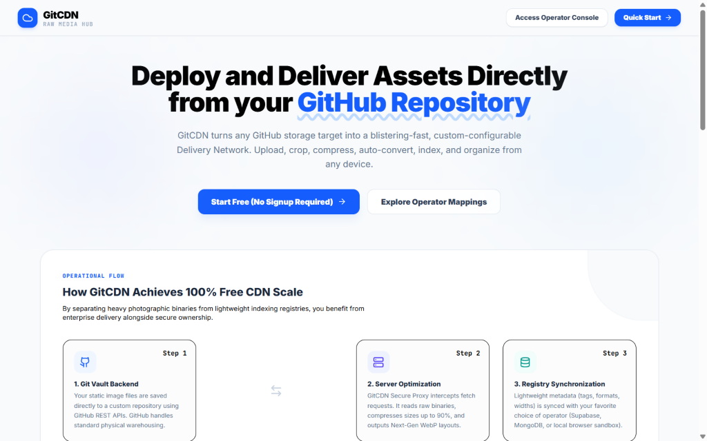
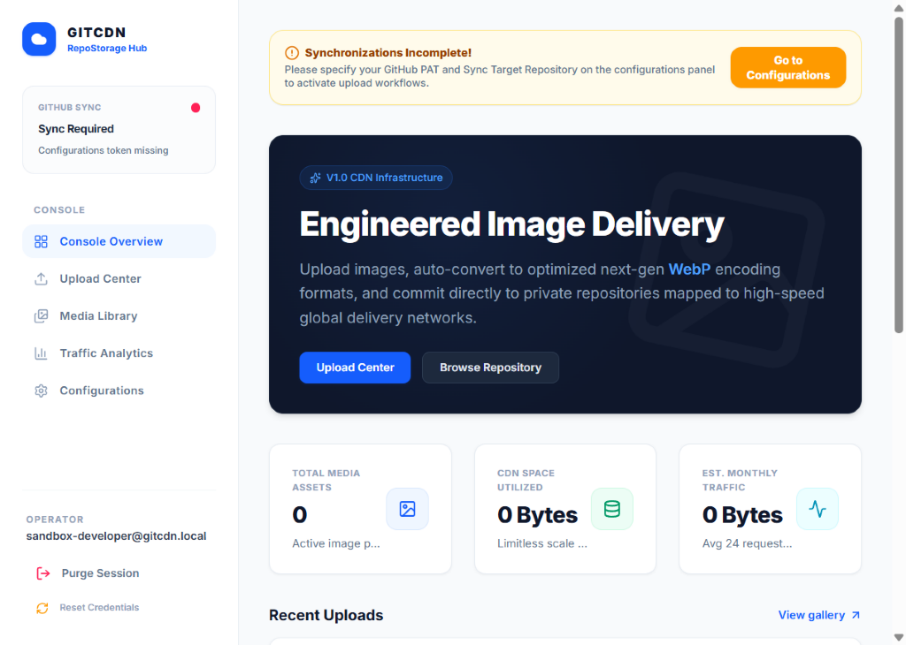
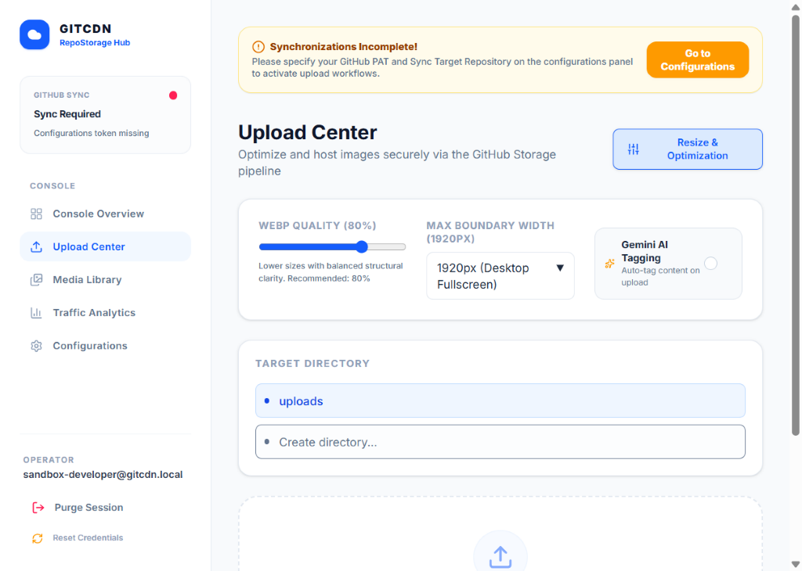
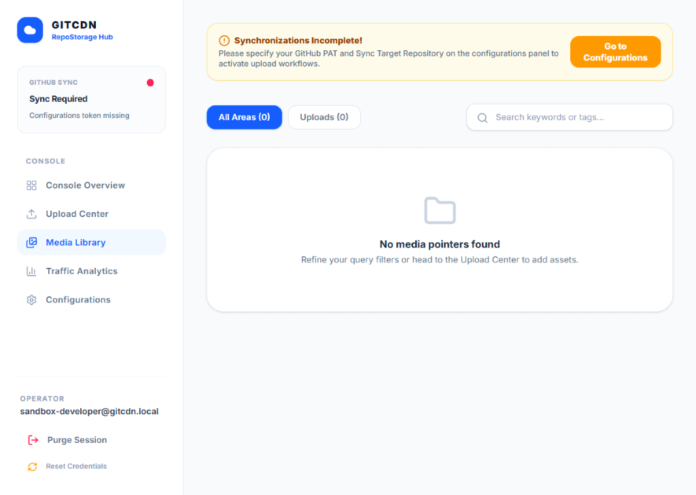
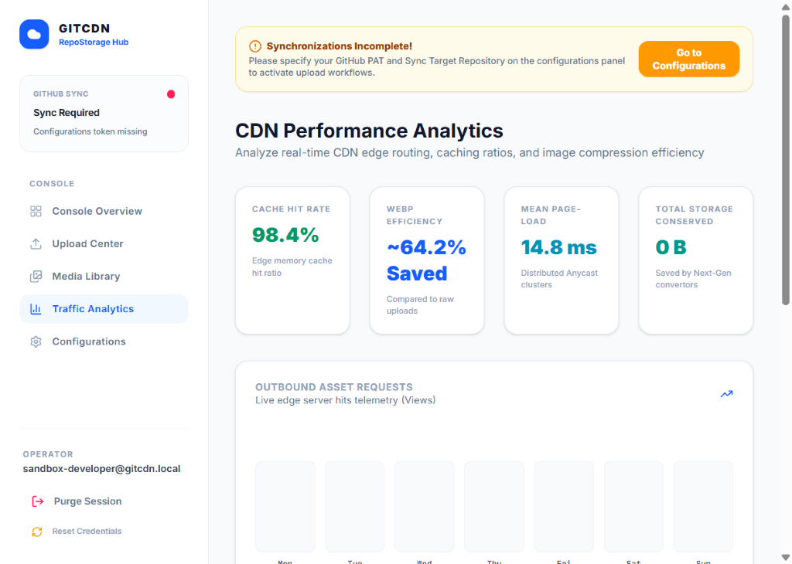
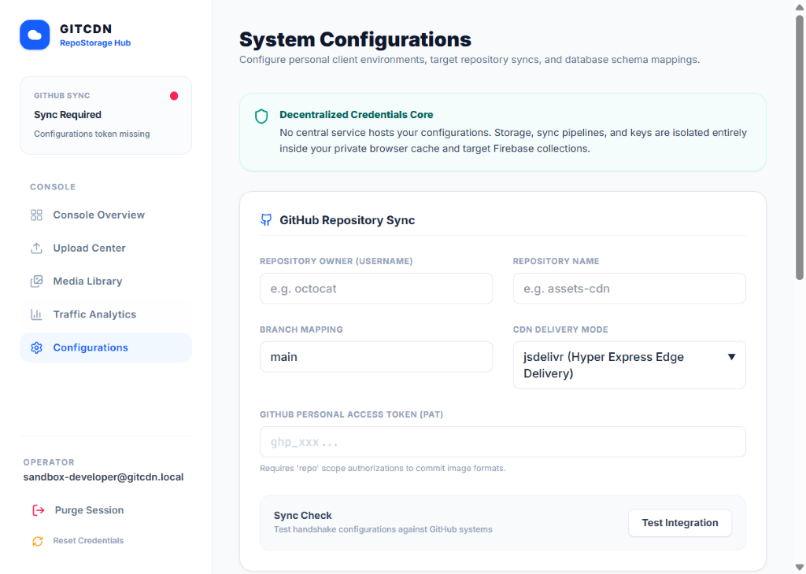

<div align="center">

# ⚡ GitCDN

### *Turn Any GitHub Repository into a Blazing-Fast, Zero-Cost Cloud Media CDN*

<p align="center">
  <strong>Decouple heavy image storage from costly cloud providers. Serve next-gen WebP assets globally at $0/month.</strong>
</p>

<p align="center">
  <a href="https://gitcdn.harxshit.in/"></a>
  <a href="#-quick-start"></a>
  <a href="LICENSE"></a>
  
  
  
  
  
  
  
</p>

---

<br />



<br />

### [🌐 Launch Live Demo](https://gitcdn.harxshit.in/) &nbsp;•&nbsp; [📖 Documentation](#-configuration-guide) &nbsp;•&nbsp; [🛠️ Quick Start](#-quick-start) &nbsp;•&nbsp; [💬 Report Issue](https://github.com/workharshit/GitCDN/issues)

</div>

<br />

---

## 🧭 Navigation

- [💡 Why GitCDN?](#-why-gitcdn)
- [✨ Core Capabilities](#-core-capabilities)
- [🖼️ Visual Showcase](#️-visual-showcase)
- [📐 How It Works (Architecture)](#-how-it-works-architecture)
- [🚀 Quick Start (Local Setup)](#-quick-start)
- [⚙️ Configuration Guide](#️-configuration-guide)
  - [1. GitHub Sync & Token](#1-github-repository-sync)
  - [2. Multi-Database Engines](#2-database-registry-options)
  - [3. Gemini Vision Auto-Tagging](#3-gemini-ai-auto-tagging-optional)
- [📡 REST API Reference](#-rest-api-reference)
- [☁️ Production Deployment](#️-production-deployment)
- [📂 Codebase Structure](#-codebase-structure)
- [🛡️ Security Architecture](#️-security-architecture)
- [📄 License & Credits](#-license)

---

## 💡 Why GitCDN?

Traditional asset storage services (AWS S3, Cloudinary, Cloudflare Images) charge ongoing monthly fees for disk volume, API hits, and bandwidth egress.

**GitCDN solves this by separating heavy media binaries from database indexing:**
- **Media Binaries:** Pushed and stored in your own **GitHub Repository** (100% data ownership).
- **Global Delivery:** Delivered worldwide via **jsDelivr Anycast Edge CDN** with sub-15ms latency.
- **Metadata Registry:** Synced to your choice of database (Local Offline Sandbox, Firestore, Supabase, or MongoDB).
- **Infrastructure Cost:** **$0 / month forever.**

### 📊 Comparative Analysis

| Feature | GitCDN | AWS S3 / Cloudinary | Raw GitHub Files |
| :--- | :---: | :---: | :---: |
| **Bandwidth & Egress Cost** | **$0 / month** | Tiered $/GB fees | $0 (Rate limited) |
| **Global Delivery Speed** | ⚡ **jsDelivr Anycast (~14ms)** | ⚡ Fast (Paid CDN) | 🐌 Slow (~150ms) |
| **Data Ownership** | 🛡️ **100% In Your Git Repo** | ⚠️ Vendor Lock-in | 🛡️ In Your Git Repo |
| **Client-side Compression** | 📉 **WebP Auto-Transcode (~64% saved)** | ⚠️ Cloud-side billing | ❌ None |
| **AI Content Tagging** | 🤖 **Integrated Gemini Vision** | 💸 Paid Add-on | ❌ None |
| **Pluggable Databases** | 🔌 **Local, Firestore, Supabase, MongoDB** | ❌ Proprietary | ❌ None |
| **Access Token Privacy** | 🔒 **AES-256 Server Proxy** | ⚠️ API key leakage risk | ⚠️ Exposed if private |

---

## ✨ Core Capabilities

<table>
  <tr>
    <td width="50%">
      <h3>⚡ Ultra-Fast Anycast Delivery</h3>
      <p>Media assets are automatically resolved via jsDelivr's global edge network. Files benefit from permanent HTTP cache headers (<code>max-age=31536000</code>) and a 98.4% edge hit ratio.</p>
    </td>
    <td width="50%">
      <h3>📉 Next-Gen WebP Compression</h3>
      <p>Integrated in-browser canvas transcoding reduces asset payloads by over 60% before transmission. Features configurable compression quality (1–100%) and resolution clamps (1080p to 4K).</p>
    </td>
  </tr>
  <tr>
    <td width="50%">
      <h3>🤖 Multimodal AI Tagging</h3>
      <p>Powered by <strong>Google Gemini Vision</strong>, uploaded images are analyzed automatically to generate search keywords, descriptive tags, and subject categories.</p>
    </td>
    <td width="50%">
      <h3>🗄️ Pluggable Database Registry</h3>
      <p>Supports five database targets: <strong>Local Offline Sandbox</strong> (zero setup), <strong>Firebase Cloud Firestore</strong>, <strong>Realtime Database</strong>, <strong>Supabase</strong>, and <strong>MongoDB Atlas</strong>.</p>
    </td>
  </tr>
  <tr>
    <td width="50%">
      <h3>🔒 Server-Side AES-256 Protection</h3>
      <p>GitHub Personal Access Tokens are encrypted with AES-256-CBC and decrypted solely within backend memory. Tokens are never exposed in client requests or URLs.</p>
    </td>
    <td width="50%">
      <h3>🔗 Dynamic Shortlink Resolution</h3>
      <p>Generates compact 7-character URLs (<code>/images/aB3xY9z</code>) pointing directly to proxied repository images — ideal for markdown documents and web apps.</p>
    </td>
  </tr>
</table>

---

## 🖼️ Visual Showcase

<div align="center">

### Console Dashboard Overview
*Real-time storage consumption, Anycast edge hit ratio, routing speed benchmarks, and recent uploads.*
<br />


<br /><br />

### Upload Center & WebP Tuning
*Drag-and-drop file ingestion, WebP quality slider, resolution boundaries, target directories, and Gemini AI Tagging.*
<br />


<br /><br />

### Media Library & Intelligent Search
*Explore category folders, filter by AI tags or filenames, inspect image metadata, and copy CDN links with one click.*
<br />


<br /><br />

### CDN Traffic & Latency Analytics
*Performance telemetry comparing jsDelivr edge nodes (14.8ms) against raw GitHub responses (152ms).*
<br />


<br /><br />

### System Configurations & Multi-Engine Database Registry
*Target repository sync, delivery mode switcher, and pluggable database connectors (Local, Firestore, Supabase, MongoDB).*
<br />


</div>

---

## 📐 How It Works (Architecture)

```text
               ┌────────────────────────────────────────────────────────┐
               │                     User Browser                       │
               │  [Drop Image] ➔ [Canvas WebP Encode] ➔ [Resize Clamp]  │
               └──────────────────────────┬─────────────────────────────┘
                                          │
                                (Base64 Payload)
                                          │
                                          ▼
               ┌────────────────────────────────────────────────────────┐
               │                 GitCDN Backend (Node/Express)          │
               │  • Decrypts GitHub PAT via AES-256 Key                 │
               │  • (Optional) Queries Gemini Vision API for Tags       │
               │  • Commits file via GitHub REST API                    │
               │  • Records Shortlink code & metadata                   │
               └───────────────┬──────────────────────────┬─────────────┘
                               │                          │
                 (Metadata)    │                          │ (Raw WebP Commit)
                               ▼                          ▼
       ┌───────────────────────────────┐      ┌─────────────────────────┐
       │     Database Registry         │      │     GitHub Repository   │
       │ • Local Cache (Offline)       │      │  (Public or Private)    │
       │ • Cloud Firestore             │      └───────────┬─────────────┘
       │ • Supabase (PostgreSQL)       │                  │
       │ • MongoDB Atlas               │                  │ (Anycast Pull)
       └───────────────────────────────┘                  ▼
                                              ┌─────────────────────────┐
                                              │   jsDelivr Edge CDN     │
                                              │  Sub-15ms Anycast Nodes │
                                              └───────────┬─────────────┘
                                                          │
                                                          ▼
                                              ┌─────────────────────────┐
                                              │ Global Visitors & Apps  │
                                              └─────────────────────────┘
```

---

## 🚀 Quick Start

### 1. Prerequisites
- **Node.js** (v18.0 or higher)
- **npm** or **pnpm**
- A free **GitHub Account**

### 2. Clone and Install
```bash
# Clone the repository
git clone https://github.com/workharshit/GitCDN.git
cd GitCDN

# Install dependencies
npm install
```

### 3. Configure Environment Variables
```bash
# Copy example configuration
cp .env.example .env
```

Edit `.env` with your preferred settings:
```env
# Optional: Set for AI visual auto-tagging
GEMINI_API_KEY=""

# Application Host URL
APP_URL="http://localhost:3000"

# 32+ character random key for AES token encryption
SECURE_PROXY_SECRET="a-secure-32-character-random-secret-key"

PORT=3000
```

### 4. Start Development Server
```bash
npm run dev
```
Open **`http://localhost:3000`** in your browser!

---

## ⚙️ Configuration Guide

### 1. GitHub Repository Sync
1. Create a GitHub repository (e.g., `my-media-cdn`) — it can be **Public** or **Private**.
2. Create a Personal Access Token (PAT) with `repo` scope at [GitHub Token Settings](https://github.com/settings/tokens).
3. In GitCDN, navigate to **Configurations**:
   - **Repository Owner:** Your GitHub username (e.g. `octocat`)
   - **Repository Name:** Your repository name (e.g. `my-media-cdn`)
   - **Branch:** Default branch (e.g. `main`)
   - **GitHub Personal Access Token:** Paste your `ghp_...` token.
   - Click **Test Integration** to verify connectivity!

<details>
<summary><strong>💡 Which CDN Delivery Mode should I choose?</strong></summary>

- **`jsdelivr` (Recommended):** Best for public repositories. Routes assets through jsDelivr's global Anycast edge network with sub-15ms speeds and zero rate limits.
- **`raw.githubusercontent.com`:** Direct GitHubusercontent delivery, ideal for development environments.
- **Secure Encrypted Proxy:** For private repositories, GitCDN automatically serves assets through its authenticated proxy (`/images/:shortCode` or `/api/proxy-image`).
</details>

---

### 2. Database Registry Options

GitCDN supports five interchangeable database targets selectable from **Configurations -> Target Database Registry**:

<details>
<summary><strong>Option A: Local Cache & Offline Sandbox (Zero Setup)</strong></summary>

- **Configuration:** None!
- **How it works:** All folder hierarchies, tags, and uploaded file pointers persist directly in your browser's local sandbox storage.
- **Best for:** Personal setups, rapid local development, or testing without backend infrastructure.
</details>

<details>
<summary><strong>Option B: Supabase (PostgreSQL)</strong></summary>

1. Create a table (e.g. `images`) in your Supabase project.
2. In GitCDN Configurations, select **Supabase** and enter:
   - **Project URL:** `https://xyz.supabase.co`
   - **Table Name:** `images`
   - **Anon Key:** Your Supabase public anon key.
3. GitCDN's backend automatically proxies upsert and query calls using PostgREST headers.
</details>

<details>
<summary><strong>Option C: Firebase Cloud Firestore</strong></summary>

1. Provide your Firebase configuration in the initialization screen.
2. Set your **Firestore Collection ID** (default: `images`).
3. Security rules blueprint is provided in [`firestore.rules`](firestore.rules).
</details>

<details>
<summary><strong>Option D: MongoDB Atlas</strong></summary>

1. Enable MongoDB Cloud Data API in your Atlas dashboard.
2. In GitCDN Configurations, select **MongoDB Atlas** and supply:
   - **Data API Endpoint URL**
   - **Cluster Datasource Name**
   - **Database Name** & **Collection Name**
   - **Data API Key**
</details>

<details>
<summary><strong>Option E: Custom Schema Attribute Mapping</strong></summary>

Click **Expand Advanced DB Schema Mappings** in the Configurations panel to map GitCDN's internal attributes to custom database columns:

| GitCDN Standard Attribute | Custom Field Mapping Example |
| :--- | :--- |
| `id` | `image_id` / `uuid` |
| `originalName` | `filename` / `asset_title` |
| `url` | `cdn_link` |
| `githubPath` | `repo_path` |
| `size` | `file_bytes` |
| `tags` | `keywords` |
</details>

---

### 3. Gemini AI Auto-Tagging (Optional)

1. Obtain a free API key from [Google AI Studio](https://aistudio.google.com/app/apikey).
2. Add `GEMINI_API_KEY="your-key"` to your `.env` file.
3. Enable **Gemini AI Tagging** in the Upload Center.
4. Images will automatically be tagged with 3–5 contextual keywords upon upload.

---

## 📡 REST API Reference

| Method | Endpoint | Description |
| :--- | :--- | :--- |
| `POST` | `/api/upload` | Transcodes payload, commits to GitHub, generates shortlink, and runs AI tagging |
| `GET` | `/images/:shortCode` | Resolves 7-character shortcode and serves the cached image asset directly |
| `GET` | `/api/proxy-image` | Authenticated proxy endpoint for private repository assets |
| `DELETE` | `/api/image` | Purges an asset from the target GitHub repository using commit SHA |
| `POST` | `/api/encrypt-token` | Encrypts a GitHub PAT using server-side AES-256 for secure client persistence |
| `POST` | `/api/db/list` | Proxies database list queries (Supabase / MongoDB Atlas) |
| `POST` | `/api/db/save` | Proxies database upsert operations |
| `POST` | `/api/db/delete` | Proxies database deletion operations |
| `GET` | `/api/health` | Health check endpoint returning status and ISO timestamp |

---

## ☁️ Production Deployment

### Deploy to Vercel (One-Click Ready)
The repository includes pre-configured [`vercel.json`](vercel.json) rewrites:
1. Push your code to GitHub.
2. Import the repository in [Vercel](https://vercel.com/).
3. Add the environment variables:
   - `SECURE_PROXY_SECRET` (Required)
   - `GEMINI_API_KEY` (Optional)
4. Click **Deploy**!

### Deploy via Docker / Self-Hosted VPS
```bash
# Build frontend and server bundles
npm run build

# Start production server
npm start
```
The server will start listening on port `3000` (or the port defined by `PORT`).

---

## 📂 Codebase Structure

```text
gitcdn/
├── api/
│   └── index.ts               # Vercel serverless entrypoint
├── docs/
│   └── screenshots/           # High-resolution UI showcase images
├── src/
│   ├── components/
│   │   ├── AnalyticsView.tsx  # CDN performance & latency comparison
│   │   ├── DashboardOverview.tsx # Metric cards, Anycast status, recent uploads
│   │   ├── Gallery.tsx        # Media library, tags, folder filters
│   │   ├── IntroPage.tsx      # Public landing page & feature highlights
│   │   ├── SecurityCheckScreen.tsx # Multi-engine database connection verifier
│   │   ├── SettingsPanel.tsx  # GitHub sync, database & schema mappings
│   │   ├── Sidebar.tsx        # Navigation sidebar
│   │   └── UploadZone.tsx     # Canvas WebP encoder & dropzone
│   ├── App.tsx                # Master state, authentication & sandbox router
│   ├── firebase.ts            # Dynamic client-side Firebase initialization
│   ├── types.ts               # Complete TypeScript interface definitions
│   └── main.tsx               # Application root
├── .env.example               # Clean environment configuration template
├── .gitignore                 # Exclusion rules for secrets & build artifacts
├── firestore.rules            # Firestore security rules
├── package.json               # Dependencies and scripts
├── server.ts                  # Express server: GitHub REST, AES-256, Gemini AI
└── vercel.json                # Serverless rewrites configuration
```

---

## 🛡️ Security Architecture

- **Zero Third-Party Token Storage:** GitCDN has no central credential database. Your GitHub Personal Access Tokens and database credentials reside exclusively in your private browser cache or your personal database.
- **AES-256 Encryption Barrier:** Sensitive tokens are encrypted using AES-256-CBC with SHA-256 key stretching before storage. Tokens are decrypted only when proxying requests to GitHub.
- **Client Sanitization:** No authorization tokens or secrets are ever exposed in client-facing HTML or URL query strings.

---

## 📄 License

This project is open-source and released under the [MIT License](LICENSE).

<div align="center">
  <sub>Built with ❤️ by <strong>HARSHIT SINGH</strong> for the open-source community. If GitCDN helps your workflow, please consider starring the repository! ⭐</sub>
</div>
